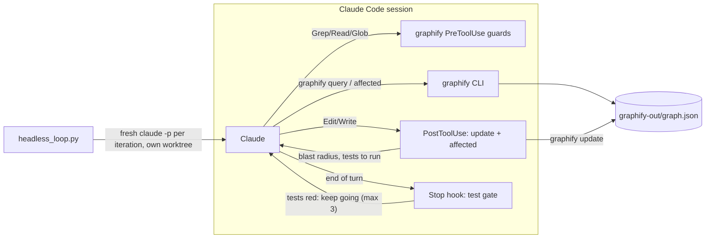

# replicable

**A Claude Code plugin that adds verification and loops to the agent harness,
built on [graphify](https://github.com/Graphify-Labs/graphify)'s code graph.**
Graphify builds and queries the graph; this plugin adds what graphify doesn't:
automatic re-indexing with a blast-radius report after every edit, a test
gate the agent can't skip, focused subagents, workflow skills, and a bounded
headless loop. It works in any git repository.

> An agent is only as good as its feedback loop. Regressions, slow iteration
> and "done" claims that aren't true usually mean the agent cannot cheaply see
> what its change affects, or nothing makes it check. This plugin fixes both
> in the harness, so the agent doesn't have to remember to do it.

## Who does what

| Harness layer | Provided by | Component | What it does |
| --- | --- | --- | --- |
| **Code graph** | graphify | `graphify update`, `graphify-out/graph.json` | A tree-sitter graph of ~40 languages: `calls`, `imports`, `inherits`, `references` and more, each tagged `EXTRACTED` or `INFERRED` |
| **Queries** | graphify | `graphify query / explain / path / affected / god-nodes`, and `graphify-mcp` | Scoped answers instead of reading whole files |
| **Graph-first rules** | graphify | `graphify claude install` | A `## graphify` section in `CLAUDE.md`, plus PreToolUse guards on Grep, Read and Glob that steer Claude to the graph first |
| **Context + verification** | this plugin | PostToolUse hook | After every edit: `graphify update`, then `graphify affected <file>`, then "can affect N symbols; tests to run: …" |
| **Setup** | this plugin | SessionStart hook, `setup` skill | Builds the graph the first time (code only, no LLM), offers graphify's installer, and creates or upgrades the project wiki and its CI check |
| **Wiki freshness** | this plugin | PostToolUse + SessionStart hooks | Editing code a wiki page describes names that page; pages left unupdated are listed at the next session start |
| **Control flow** | this plugin | Stop hook (opt-in) | Claude can't end a turn while the tests are red. Bounded to 3 retries |
| **Context isolation** | this plugin | `graph-explorer`, `reviewer` subagents | Graph-first exploration and independent review in their own context windows |
| **Procedures** | this plugin | Skills | `setup`, `epcc` (Explore → Plan → Code → Commit), `tdd`, `test-gate`, `headless-loop`, `wiki-ingest`, `wiki-lint` |
| **Orchestration** | this plugin | Loops | A headless "Ralph" loop with an isolated worktree, caps and an objective definition of done |



## Install

**1. Install graphify** (it needs Python 3.10+; `uv` or `pipx` bring their own Python):

```bash
uv tool install "graphifyy[mcp]"     # or: pipx install graphifyy
```

The PyPI package is `graphifyy` (double y); the command is `graphify`.

**2. Install the plugin** from inside Claude Code:

```
/plugin marketplace add replicablelabs/replicable-plugin
/plugin install replicable@replicablelabs
```

Or try it for a single session without installing:

```bash
git clone https://github.com/replicablelabs/replicable-plugin ~/replicable-plugin
cd your-project && claude --plugin-dir ~/replicable-plugin
```

**3. Set up each project** with `/replicable:setup`. It shows the
detected settings, runs graphify's own Claude Code installer once you approve
(that writes to `CLAUDE.md` and `.claude/settings.json`), builds the graph and
records the test command.

To have a whole team prompted to install the plugin, commit this to the
project's `.claude/settings.json`:

```json
{
  "extraKnownMarketplaces": {
    "replicablelabs": { "source": { "source": "github", "repo": "replicablelabs/replicable-plugin" } }
  },
  "enabledPlugins": { "replicable@replicablelabs": true }
}
```

## Privacy

The plugin's hooks only run `graphify update`, which parses **code locally with
tree-sitter and sends nothing to an LLM**. Graphify's *full* extraction (the
`/graphify` skill or `graphify extract` without `--code-only`) sends documents,
PDFs and images to an LLM backend. For closed-source projects, run only
code-only commands unless you've decided that's acceptable.

## Configure (optional)

The test command is detected automatically. To override it, commit
`.claude/replicable.json`:

```json
{ "test": "pnpm test --filter=api" }
```

Detection order: `make test`, the `package.json` `test` script (npm, pnpm,
yarn or bun), `go test ./...`, `cargo test`, then pytest or unittest (using
the project's `.venv` if present). To keep files out of the graph, use
graphify's `.graphifyignore`.

The plugin's own state (test-gate markers, loop worktrees and progress notes)
lives in `$XDG_CACHE_HOME/replicable/<project>-<hash>/` (default
`~/.cache/...`). The graph is graphify's, in `graphify-out/`. Ask Claude to call
the plugin's `info` tool to see the resolved settings.

Environment overrides: `HARNESS_ROOT`, `HARNESS_DATA`, `GRAPHIFY_BIN`,
`LAB_TEST_CMD`, `LAB_TEST_GATE=1`, `LAB_TEST_GATE_MAX`.

## Use

Skills are namespaced, so type `/replicable:` to list them.

**Ask structural questions.** Graphify's rules steer Claude to `graphify query
"…"`, `graphify path A B` and `graphify explain X` before it greps or reads
files.

**Use the verification loop.** After any edit, the PostToolUse hook re-indexes
the graph and adds the affected symbols and tests to Claude's context.
`/replicable:test-gate on` keeps Claude working until the suite is
green, up to 3 attempts.

**Recommended workflows:**
- `/replicable:epcc <task>`: explore, plan, code, commit. Start in
  plan mode (Shift+Tab) for risky changes.
- `/replicable:tdd <behaviour>`: tests first, committed before the
  implementation.
- **Writer / reviewer:** `claude -w feature-x` to write, then a fresh session
  with *"use the reviewer agent on branch worktree-feature-x"*.

**Loops:**

| Loop | Use it to | How |
| --- | --- | --- |
| Stop hook | Keep Claude working while the tests are red | `/replicable:test-gate on` |
| Headless "Ralph" loop | Work toward a long, well-specified goal | `/replicable:headless-loop <goal>` (explains the command and asks before running) |
| Graph freshness | Keep the graph current outside Claude sessions | Graphify's `graphify hook install` (on commit and checkout) or `graphify watch` |
| `/loop` and routines | Recurring checks | e.g. `/loop 30m run graphify god-nodes and tell me if the top hubs changed` |

The headless loop starts a **fresh `claude -p` process each iteration**.
Memory between iterations lives in a `PROGRESS.md` outside the repo and in one
checkpoint commit per iteration. **Done** means the tests pass *and* the agent
printed `<promise>DONE</promise>`; a claim of done while the tests fail is sent
back as feedback. **Guardrails:** an isolated worktree and branch
(`loop/<name>`), a per-iteration `--max-budget-usd`, an iteration cap, and
`acceptEdits` plus an allowlist (edits, the test command, read-only git and
graphify commands; no network, no push). `--dry-run` prints the command
without running it.

## Limitations

- **The graph is graphify's.** Its precision, languages and the meaning of
  `INFERRED` edges are graphify's; check its documentation.
- **The blast radius is static.** Dynamic dispatch, reflection and string
  imports can be missed. The `graph-explorer` agent confirms "no callers"
  with one targeted grep.
- **Re-indexing after an edit takes about 1 s** (graphify's incremental update,
  measured on small repositories). Larger repositories will take longer.
- **Hooks run locally with your permissions.** Read them before enabling the
  plugin, as you would for any plugin.

## Docs

- [Harness engineering](docs/harness-engineering.md): harness layers, inner and outer loops, loop engineering, and the code graph, wiki and plan graph
- [Hooks for coding agents](docs/hooks.md): metrics, practices, a catalogue of hooks (implemented and proposed), and hooks that call LLMs
- [Project wiki](docs/wiki.md): a Karpathy-style intent wiki per project, maintained by Claude Code and readable in Obsidian (CLI, setup, skills and hooks implemented; trial next)

## Develop

```bash
python3 -m unittest discover -s tests -v   # graphify tests are skipped if it isn't installed
claude plugin validate .
claude --plugin-dir .                       # dogfood
```

See [`CLAUDE.md`](CLAUDE.md) for the rules this codebase follows.

## License

[MIT](LICENSE) © Replicable Labs
