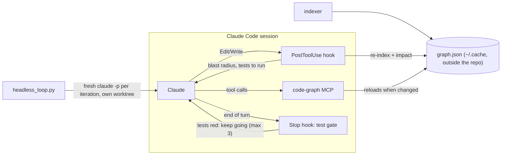

# replicable-harness

**A Claude Code plugin that adds context, verification and loops to the agent
harness.** It adds a code-graph MCP server, hooks that make verification
automatic, two focused subagents, workflow skills, and bounded agentic loops.
It works in any git repository and has no dependencies beyond Python 3.9+.

> An agent is only as good as its feedback loop. Regressions, slow iteration
> and "done" claims that aren't true usually mean the agent cannot cheaply see
> what its change affects, or nothing makes it check. This plugin fixes both
> in the harness, so the agent doesn't have to remember to do it.

## What it adds

| Harness layer | Component | What it does |
| --- | --- | --- |
| **Tools** | `code-graph` MCP server | A static graph of the repo: modules, classes, functions, with `imports`, `calls`, `inherits` and `defines` edges. Tools: `overview`, `search`, `symbol`, `callers`, `callees`, `impact`, `path`, `mermaid`, `drift`, `test_gate`, `harness_info`, `reindex` |
| **Context** | SessionStart hook | Opens each session with a compact map of the repo |
| **Context + verification** | PostToolUse hook | After every edit, re-indexes the graph and tells Claude what the change can affect and which tests to run |
| **Control flow** | Stop hook (opt-in) | Claude can't end a turn while the tests are red. Bounded to 3 retries |
| **Context isolation** | `graph-explorer`, `reviewer` subagents | Exploration and independent review run in their own context windows |
| **Procedures** | Skills | `epcc` (Explore → Plan → Code → Commit), `tdd`, `graph-first`, `test-gate`, `graph-drift`, `map-codebase`, `headless-loop` |
| **Orchestration** | Loops | `/loop` drift checks, a headless "Ralph" loop, a Workflow fan-out |



## Install

From inside Claude Code:

```
/plugin marketplace add replicablelabs/replicable-claude
/plugin install replicable-harness@replicablelabs
```

Or try it for a single session without installing:

```bash
git clone https://github.com/replicablelabs/replicable-claude ~/replicable-claude
cd your-project
claude --plugin-dir ~/replicable-claude
```

To have a whole team prompted to install it, commit this to your project's
`.claude/settings.json`:

```json
{
  "extraKnownMarketplaces": {
    "replicablelabs": { "source": { "source": "github", "repo": "replicablelabs/replicable-claude" } }
  },
  "enabledPlugins": { "replicable-harness@replicablelabs": true }
}
```

Check that it loaded:

```bash
claude plugin details replicable-harness      # ~700 tokens added to every session
claude mcp list                               # plugin:replicable-harness:code-graph ✔
```

## Configure (optional)

Everything is detected automatically. To override it, commit
`.claude/replicable-harness.json` in your project:

```json
{
  "test": "pnpm test --filter=api",
  "exclude": ["vendor/", "migrations/"]
}
```

| Key | Default |
| --- | --- |
| `test` | Detected in this order: `make test`, the `package.json` `test` script (npm/pnpm/yarn/bun), `go test ./...`, `cargo test`, pytest or unittest (using the project's `.venv` if present) |
| `exclude` | Nothing excluded beyond `.gitignore` |

The plugin keeps its state (the graph, snapshots, gate markers, loop worktrees
and progress notes) in `$XDG_CACHE_HOME/replicable-harness/<project>-<hash>/`
(default `~/.cache/...`). It never writes into your repository. Ask Claude for
`harness_info` to see the resolved paths and settings.

Environment overrides: `CODE_GRAPH_ROOT`, `CODE_GRAPH_DATA`, `LAB_TEST_CMD`,
`LAB_TEST_GATE=1`, `LAB_TEST_GATE_MAX`.

## Use

Skills are namespaced, so type `/replicable-harness:` to list them.

**Ask structural questions.** *"What breaks if I change `parse_config`, and
which tests cover it?"* uses `impact`. *"How does the CLI reach the database
layer?"* uses `path`. *"Draw the module map"* uses `mermaid`.

**Use the verification loop.** Make any edit and the PostToolUse hook adds the
affected callers and tests to Claude's context. `/replicable-harness:test-gate
on` keeps Claude working until the suite is green, up to 3 attempts.

**Recommended workflows:**
- `/replicable-harness:epcc <task>`: explore, plan, code, commit. Start in
  plan mode (Shift+Tab) for risky changes.
- `/replicable-harness:tdd <behaviour>`: tests first, committed before the
  implementation.
- **Writer / reviewer:** `claude -w feature-x` to write, then a fresh session
  with *"use the reviewer agent on branch worktree-feature-x"*.

**Loops:**

| Loop | Use it to | How |
| --- | --- | --- |
| `/loop` | Watch the structure while you work | `/loop 15m /replicable-harness:graph-drift` reports new symbols, dependencies, import cycles and untested modules since the last check |
| Routines | Run the same check in the cloud | `/schedule`, e.g. a nightly drift report |
| Stop hook | Keep Claude working while the tests are red | `/replicable-harness:test-gate on` |
| Headless "Ralph" loop | Work toward a long, well-specified goal | `/replicable-harness:headless-loop <goal>` (explains the command and asks before running) |
| Workflow fan-out | Handle work too big for one context | `/replicable-harness:map-codebase`: one agent per module, an adversarial check, then a synthesised `ARCHITECTURE.md` |

The headless loop starts a **fresh `claude -p` process each iteration**.
Memory between iterations lives in a `PROGRESS.md` outside the repo and in one
checkpoint commit per iteration. **Done** means the tests pass *and* the agent
printed `<promise>DONE</promise>`; a claim of done while the tests fail is sent
back as feedback. **Guardrails:** an isolated worktree and branch
(`loop/<name>`), a per-iteration `--max-budget-usd`, an iteration cap, and
`acceptEdits` plus an allowlist (edits, the test command, git read commands
and the graph tools; no network, no push). `--dry-run` prints the command
without running it.

## Limitations

- **The graph reads Python only.** For code in other languages the graph tools
  have nothing to say, but the hooks, test gate, subagents, skills and loops
  work in any language. Support for more languages is the main item on the
  roadmap.
- **The analysis is static.** It misses dynamic dispatch, `getattr`,
  callbacks and string imports. The `graph-first` skill tells Claude to
  confirm "no callers" with one targeted grep.
- **Type inference is flow-insensitive:** `x = Cls(); x.m()` within a function
  is followed; types returned from other functions are not.
- **Hooks run locally with your permissions.** Read them before enabling the
  plugin, as you would for any plugin.

## Roadmap

- More languages for the graph, through tree-sitter or language-server data
- Measured evaluations with `claude plugin eval`: the same tasks run with and
  without the plugin (regressions, iterations to green, cost)
- Graph-aware review that flags changed symbols with no covering test

## Develop

```bash
python3 -m unittest discover -s tests -v   # stdlib only, Python 3.9+
claude plugin validate .
claude --plugin-dir .                       # dogfood: the plugin indexes itself
```

See [`CLAUDE.md`](CLAUDE.md) for the rules this codebase follows.

## License

[MIT](LICENSE) © Replicable Labs
